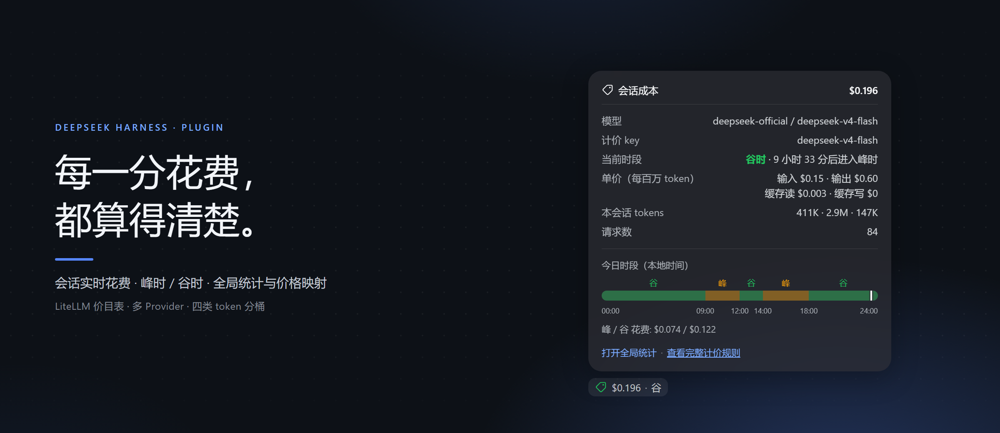
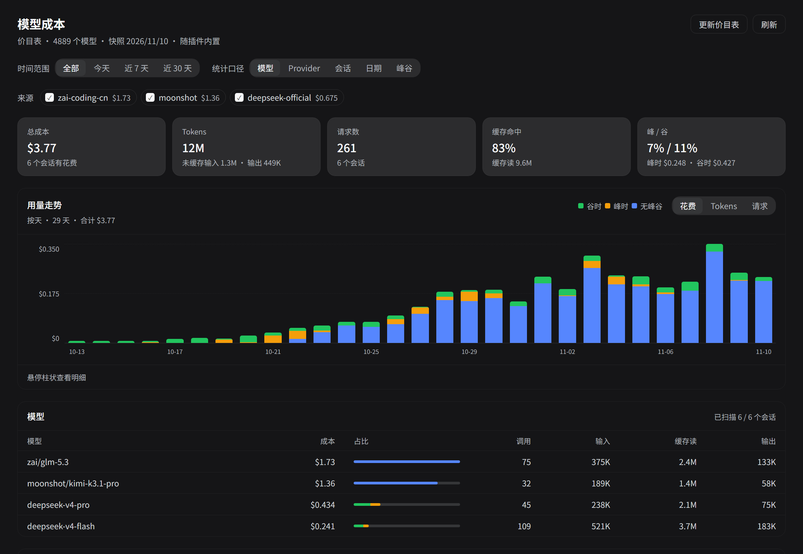
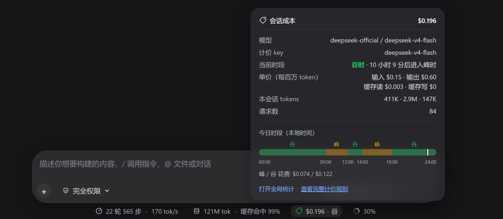
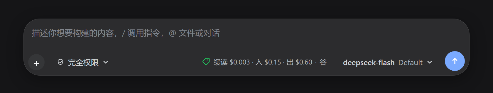
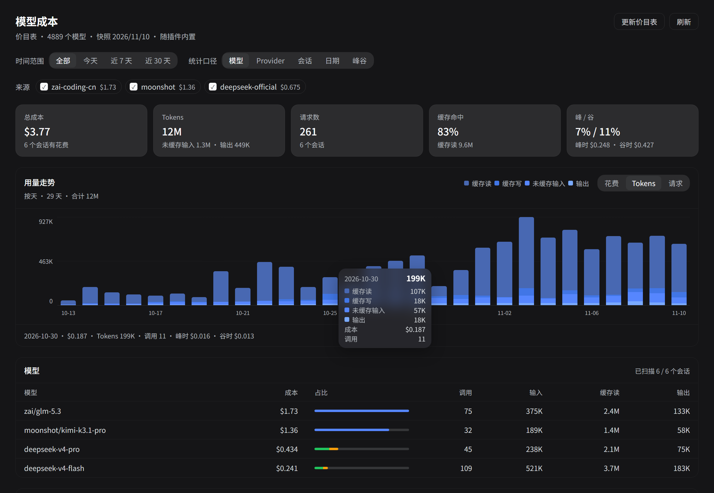

<h1 align="center">dsh-model-cost</h1>

<p align="center">
  <a href="LICENSE"></a>
  
  
</p>

<p align="center">
  
</p>

<p align="center">
  把会话日志里的每次模型调用折算成美元——输入框实时花费、峰谷定价、新会话价签、全局统计与价格映射。
</p>

DeepSeek Harness 的模型花费统计插件。它把会话日志里每次模型调用的 usage
（未缓存输入 / 缓存读 / 缓存写 / 输出）按 [LiteLLM Model Cost Map](https://github.com/BerriAI/litellm/blob/main/model_prices_and_context_window.json)
折算成美元，并按 LiteLLM 的 `off_peak_pricing` 规则判断这次调用落在**峰时**还是**谷时**——
用完成时间定价，与 LiteLLM 自身的计费口径一致。



> 文档中的截图使用模拟数据渲染：数字与峰谷判断由真实 Host 服务算出，
> 输入框外壳按 DSH 的实际布局复刻，pill、价签与弹层都是插件真实组件。

## 三个入口

| 位置 | 显示什么 |
| --- | --- |
| 输入框状态栏（`1 轮 2 步 · 383 tok/s` 同一行） | 本会话累计花费，以及当前峰/谷 |
| 新会话的输入框右下角、模型选择器旁 | 选中模型当前档位的单价：缓读 · 缓写 · 入 · 出 |
| 左侧栏「模型成本」 | 全局统计页：范围、分组、走势、来源筛选、价格映射 |

### 1. 会话成本 pill



- 挂在输入框下方的状态栏里（与 `22 轮 565 步 · 170 tok/s`、`121M tok · 缓存命中 99%` 同一行），
  右边是上下文占用环。
- 图标颜色表示当前档位：峰时黄（`--dsw-alias-state-warn-primary`）、谷时绿（`--dsw-alias-state-success-primary`）、
  该模型没有峰谷价时用正常文字色、未映射到价格时红。
- 悬停（或点击钉住）展开详情：模型路由、计价 key、当前时段与「多久后进入峰/谷」、
  每百万 token 的输入/输出/缓存读/缓存写单价、**今天的时间条**（按本地时区把一天切成峰/谷区段，
  上方标峰/谷、下方标时间刻度、条内画出「现在」的位置）、
  本会话 tokens 与请求数、峰/谷花费拆分，以及按模型的花费明细。
- 面板底部给出「查看完整计价规则」链接，指向价目表条目自带的 `source`（供应商官方定价页）；
  条目没有 `source` 时退回 [models.litellm.ai](https://models.litellm.ai/)。
- 会话还没有任何计费调用时不显示，避免空占位。

### 2. 新会话的模型价签



- 位于输入框底部工具栏，紧挨模型选择器左边。

- 顺序是**缓存读、缓存写、输入、输出**，缩写为 `缓读 / 缓写 / 入 / 出`；每项都是
  **当前档位**下每百万 token 的单价，颜色随峰谷变化（与 pill 同一套配色）。
- 缓存读 / 缓存写的价格是 0 或不存在时，对应项不显示（面板里仍列出全部四项，0 也照写）。
- 价签跟着模型选择器走：在同一个输入框里换模型，价格立刻跟着换，不用重载页面。
- 点开（或悬停）是和会话成本面板同一副版式：模型路由、计价 key、当前时段、
  四项单价、今天的时间条、计价规则链接——只是**不含请求数、tokens、花费**，
  这时还没有会话可统计。
- 发出第一条消息后价签隐藏，改由输入框下方的会话成本 pill 显示本会话花费。

### 3. 全局统计页

- **时间范围**：全部 / 今天 / 近 7 天 / 近 30 天。
- **统计口径**：模型、Provider、会话、日期、峰谷。
- **来源筛选**：工具栏下方按 provider 列出该范围内每个来源的花费，点一下就把这个来源
  从概览卡片、走势图和分组表里去掉，再点恢复。选择记在浏览器本地（`localStorage`），
  下次打开页面仍生效；价格映射表始终列出全部路由，免得被藏起来的来源无法修价。
- **概览卡片**：总成本、总 tokens、请求数、缓存命中率、峰/谷占比、未定价调用数。
- **用量走势图**：按天一根柱子的花费 / Tokens / 请求走势，可在三种指标间切换。
  花费模式下柱子按峰（黄）/ 谷（绿）/ 无峰谷（DeepSeek 蓝）堆叠；**Tokens 模式**把
  缓存读、缓存写、未缓存输入、输出拆成四段，用四档蓝色区分（缓存读最浅、输出最深），
  图例、悬停卡片和柱子使用同一组颜色。没有记录的日子画成空位，时间轴按真实日期连续铺开，不会把空档挤掉。
  时间跨度长时自动汇总：超过 120 天按周、超过 540 天按月，标题会注明当前口径。
  **范围内只有一天数据时（例如「今天」）自动改成按小时展开**：24 根柱子、刻度为 00/04/08/12/16/20/23。
  悬停任意柱子，一个跟随指针的卡片给出那个时段（天/周/月/小时）的日期、峰/谷花费拆分、
  四类 token 各自的数量与请求数。卡片在柱子之间移动时连续跟随，靠近右侧或底部时自动翻到指针另一侧。



- **分组表**：每组成本、占比条形（同样按峰/谷/无峰谷填色）、调用数、输入/缓存读/输出 tokens。
  标题旁显示扫描了多少个会话，以及其中多少个直接来自本地缓存。
- **价格映射**：列出会话记录里观察到的每一条 `provider / model` 路由，
  显示当前解析结果（自动 / 多义 / 未定价）与它使用的价目表 key，并可改成本地映射规则。
  规则按 `provider + model` 或仅 `model` 生效，保存后立即用于统计与 pill。

## 安装

需要已安装 DeepSeek Harness Desktop。

```powershell
git clone https://github.com/SiskonEmilia/dsh-model-cost
cd dsh-model-cost
pwsh -File .\install-desktop.ps1
```

脚本用 Desktop 自带的 Electron Node 运行 `dsh plugin --profile desktop add`，
把插件作为 bundle 写进 `~/.dsh/profiles/desktop`。装完需要重启 Desktop 才会加载 Host 半边；
已在运行时改过 `index.js`（Host 代码）也一样——重启 Desktop，或在 Settings → Plugins 里把
`dsh-model-cost` 关掉再打开，让 Cordis 重新 import Host 模块。改 `client.js` 只需刷新页面。

## 数据与隐私

- 只读本地会话日志，取其中每次调用的 provider / model、usage 和完成时间，不读取消息正文。
- 统计缓存与映射规则只写本地 `$DSH_HOME/model-cost/`，不上传。
- 唯一的外网请求是点「更新价目表」时拉取 LiteLLM 的公开 JSON；内置快照已随插件分发。

## 计价规则

- 单位：LiteLLM 价目表统一是 **USD / token**；界面上的「单价」显示为每百万 token。
- 分桶：`input_cost_per_token`、`output_cost_per_token`、`cache_read_input_token_cost`、
  `cache_creation_input_token_cost`；某项缺失时按该条目的 input 价计（缓存读还会先尝试
  `input_cost_per_token_cache_hit`）。
- 峰谷：`off_peak_pricing` 的 `hours_utc`（支持字符串或数组）、`windows[].weekdays`、
  `weekday_timezone` 全部支持；窗口可跨午夜，`00:00-00:00` 表示全天；命中窗口时用块内单价**替换**标准单价。
  UI 上按浏览器时区把「今天」切成峰/谷区段画成时间条（完整周规则去供应商定价页看）。
- 请求按 `assistant/message` 事件的完成时间定价。
- **fork 子会话只计自己产生的调用**：fork 时父会话的事件前缀会原样复制进子会话日志
  （`inheritedEventCount` 之前的那些事件），这些调用已经记在父会话名下，所以扫描时跳过，
  全局合计不会重复。会话成本面板的标题金额写成 `$0.238 (+fork $1.23)` —— 括号里是
  fork 前的继承花费，底部注释说明当前会话是 fork、与父对话分别计算。
  前缀是 fork 时刻的冻结副本：父会话之后新增的消息只追加到父会话日志，不会进入子会话，
  「fork 前」金额因此不会随父会话继续活动而变化。
- 长上下文阶梯价（`input_cost_per_token_above_200k_tokens` 等）、批量/优先档
  （`_batches` / `_priority` / `_flex`）、图片/音频/秒计费暂不参与计算。

## 本地缓存

统计页与会话面板读同一份「每会话已解析的 usage 行」。这份数据按会话落盘在
`$DSH_HOME/model-cost/cache/<session>.json`，重启后不再重读未变化的日志：

- **格式版本**：每个文件带 `version`。当前实现不认识的版本直接当未命中，读完日志后覆盖重写。
- **增量依据**：文件里记着读日志时 `sessionPersistence` 给出的 `revision`（由文件 stat 派生，
  追加或改写都会变）。下次统计先比对 revision：一致就直接用缓存，**不打开日志**；
  不一致才重读该会话，并复用已解析的前缀、只解析追加的尾部。
  活跃会话（`ctx.sessions` 里还在内存中的）不走磁盘缓存——它们的事件可能比已刷盘的新，
  直接按内存增量解析；只有落盘且 revision 可比的会话才走缓存。
- **计价签名**：`pricing` = 计价引擎版本（`PRICING_VERSION`）+ 价目表内容指纹 + 映射规则指纹。
  签名一致就沿用缓存里的 `cost`/`phase`；更新价目表、改映射规则或升级计价引擎后，
  只对已缓存的行重新定价，不重读日志。
- **清理**：写入走「临时文件 + rename」，中断不会留下半截文件；统计时顺手删除已不在
  会话列表里、且超过 7 天的缓存，以及一小时前的临时文件。

## 价格映射

自动解析顺序：**手动规则** → 价目表里 `model` 或 `provider/model` 完全一致 → 模型名（key 最后一段）唯一命中。
多义时按 provider 亲和度排序取第一个并标注「多义」，界面可一键改成显式规则。

规则保存在 `$DSH_HOME/model-cost/config.json`（默认 `~/.dsh/model-cost/config.json`）：

```json
{
  "version": 1,
  "rules": [
    { "provider": "zai-coding-cn", "model": "glm-5.3", "key": "zai/glm-5.3" }
  ],
  "prefs": {}
}
```

## 价目表

随插件内置一份精简快照（`data/cost-map.json`，约 1 MB，只保留计价与峰谷字段）。
页面右上角「更新价目表」会让 Host 拉取上游最新 JSON 并存到
`~/.dsh/model-cost/cost-map.json`，之后该文件优先于内置快照。

重新生成内置快照：

```sh
node tools/build-cost-map.mjs                 # 下载上游并写入 data/cost-map.json
node tools/build-cost-map.mjs path/to.json    # 用本地 JSON 生成
```

## 结构

| 文件 | 作用 |
| --- | --- |
| `index.js` | Host 半边：`modelCost` Remote 服务，读会话日志、算钱、管映射与价目表 |
| `usage.js` | 会话日志解析：跟踪 `request/header` / `request/context` 的计价路由，抽取 `assistant/message` 的 usage，跳过 fork 继承的前缀；并支持从上次读到的位置续读 |
| `pricing.js` | 纯计价引擎：窗口解析、峰谷判定、今日谷时段换算、单价与成本计算、key 解析、按日序列补空、按小时分桶（无 Cordis 依赖，可直接测试） |
| `cache.js` | 会话行缓存的文件格式：版本号、行的编码与校验、计价签名 |
| `client.js` | 浏览器半边：composer dock 的会话成本 pill、新会话的模型价签、左侧栏全局统计页 |
| `data/cost-map.json` | 内置精简价目表快照 |
| `test/pricing.test.mjs` | 计价引擎单测（`node --test "test/*.test.mjs"`） |
| `test/usage.test.mjs` | 日志解析、续读前缀校验与 fork 前缀跳过单测 |
| `test/cache.test.mjs` | 缓存格式的编解码与损坏数据拒绝 |
| `test/service.test.mjs` | Host 服务的端到端行为（重启续用缓存、追加只读尾部、改规则重定价、版本不匹配回退、来源筛选） |
| `test/support/` | 上述 Host 测试用的 Cordis / Typert 桩与模块解析钩子 |
| `tools/build-cost-map.mjs` | 从上游或本地 JSON 重新生成内置快照 |
| `tools/cli-run.mjs` | 用 Desktop 自带 Electron Node 跑任意 `dsh ...` 子命令（安装、`--dump-config` 等） |

数据来源：会话日志的 `request/header`（provider、model）与 `assistant/message`（usage、完成时间）；
会话枚举与冷会话读取走 `ctx.sessionQuery`，活跃会话走 `ctx.sessions`，
冷会话的变更判定走 `ctx.sessionPersistence` 报告的 `revision`。

## 已知限制

- 只在 `assistant/message` 携带 `usage` 时计价；适配器未上报 usage 的调用不计。
- 缓存写入价缺失时按输入价计，这是 LiteLLM 的兜底口径，个别供应商的真实账单可能不同。
- 全局统计一次最多扫描 800 个会话（按最新优先），超出的会提示截断。
- 会话详情页的标题来自 `session/title`，读取失败时回退到会话 id 前 8 位。
- 第一次统计（或缓存被清空后）仍要读一遍所有会话日志；之后只读 revision 变化过的日志。
  上次运行期间活跃的会话不写缓存（内存事件可能比已刷盘的多），重启后第一次统计会重读它们。

## 许可证

[MIT](LICENSE)
